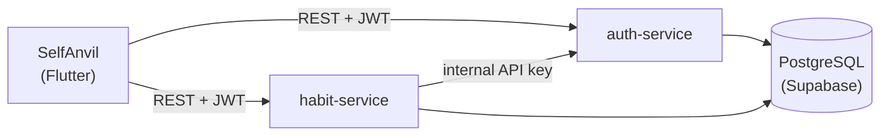

# auth-service

The accounts and sessions service behind [SelfAnvil](https://github.com/MoiBeta/Auto-Admin-App), a tasks and habits app. It registers users, logs them in and issues the JWTs that the rest of the system trusts.

| Repository | What it is |
|---|---|
| [Auto-Admin-App](https://github.com/MoiBeta/Auto-Admin-App) | Flutter client for Android |
| **auth-service** (this one) | NestJS service for accounts and JWT sessions |
| [habit-service](https://github.com/MoiBeta/habit-service) | NestJS service for habits, subtasks and reminders |

## Architecture



Both services run as Docker containers on an AWS Lightsail instance, with a managed PostgreSQL on Supabase. A Caddy reverse proxy is the only entry point: it terminates HTTPS and forwards each subdomain to its service, whose ports are not exposed to the internet.

## Tech stack

NestJS 11, TypeScript, Prisma 6, PostgreSQL, Passport (JWT), bcrypt, Swagger, Jest and Docker.

## API

Interactive documentation (Swagger UI) is live at [auth.selfanvil.app/docs](https://auth.selfanvil.app/docs).

| Method | Path | Auth | Description |
|---|---|---|---|
| `GET` | `/` | None | Health check |
| `POST` | `/auth/register` | None | Creates an account and returns the user with a token pair |
| `POST` | `/auth/login` | None | Returns the user with a token pair |
| `GET` | `/auth/me` | Access token | Returns the current user |
| `POST` | `/auth/refresh` | Refresh token | Returns a new token pair and invalidates the old refresh token |
| `POST` | `/auth/logout` | Access token | Invalidates the stored refresh token |
| `GET` | `/users` | Access token, `ADMIN` role | Lists users |
| `GET` | `/users/:id` | Internal API key | Lets other services check that a user exists |

## Design decisions

- **Short-lived access tokens with refresh token rotation.** Access tokens expire quickly (15 minutes by default). Each refresh returns a new pair and replaces the stored refresh token, so a refresh token can only be used once.
- **Refresh tokens are stored hashed, with SHA-256 and not bcrypt.** bcrypt only reads the first 72 bytes of its input, and those bytes are identical in every JWT issued to the same user, so bcrypt would accept any of them. The comparison uses `timingSafeEqual`.
- **Passwords are hashed with bcrypt**, and a failed login returns the same error whether the email exists or not.
- **Service-to-service calls use a shared key.** `habit-service` calls `GET /users/:id` with an `x-internal-api-key` header, compared in constant time. That endpoint does not accept user tokens.
- **Strict input validation.** Requests with unknown fields are rejected.

## Environment variables

Copy `.env.example` to `.env` and fill in the values.

| Variable | Description |
|---|---|
| `DATABASE_URL` | Pooled PostgreSQL connection, used at runtime |
| `DIRECT_URL` | Direct PostgreSQL connection, used for migrations |
| `JWT_SECRET` | Signs access tokens. Must be the same in `habit-service` |
| `JWT_EXPIRES_IN` | Access token lifetime, for example `15m` |
| `JWT_REFRESH_SECRET` | Signs refresh tokens |
| `JWT_REFRESH_EXPIRES_IN` | Refresh token lifetime, for example `7d` |
| `INTERNAL_API_KEY` | Shared secret for service-to-service calls. Must be the same in `habit-service` |
| `ALLOWED_ORIGINS` | Comma-separated list of allowed CORS origins |
| `PORT` | Port to listen on (defaults to 3000) |

## Running locally

Requirements: Node.js 20 and a PostgreSQL database.

```bash
npm ci
cp .env.example .env
npx prisma migrate deploy
npm run start:dev
```

With Docker:

```bash
docker build -t auth-service .
docker run --env-file .env -p 3001:3000 auth-service
```

The container applies pending migrations before it starts.

## Tests

```bash
npm test
```

## CI/CD

[.github/workflows/ci-cd.yml](.github/workflows/ci-cd.yml) runs on GitHub Actions:

1. **Every pull request and every push to `main`:** install, generate the Prisma client, build and run the tests.
2. **Pushes to `main` only:** build the Docker image, publish it to GitHub Container Registry, then connect to the server over SSH and restart the service with the new image.

## Roadmap

- Rate limiting on the login and register endpoints.
- Fix the existing lint errors and enforce lint in CI.
